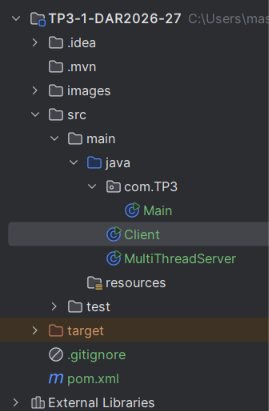
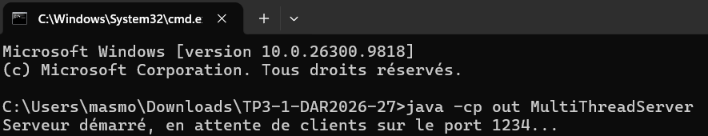
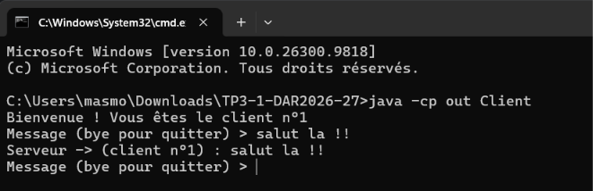
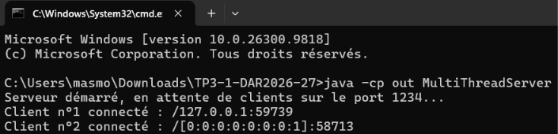
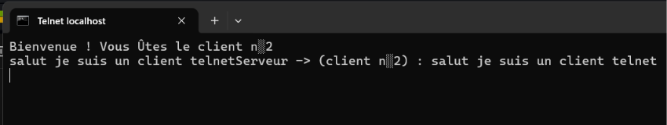
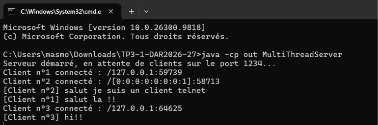

# TP3 : Serveur Multi-threads – Sockets en mode connecté TCP

## Activité 3-1 : Acceptation de plusieurs clients

---

## 1. Objectif

Comprendre et appliquer le principe d'un serveur multi-thread basé sur les sockets TCP en Java.
Ce TP étend les applications Client/Serveur des TP1 et TP2 afin d'accepter **plusieurs clients simultanément**.

## 2. Structure du projet

*Capture 1 : structure du projet `TP3-1-DAR2026-27`.*

Les deux classes de l'application se trouvent dans `src/main/java` :

- `MultiThreadServer.java` : le serveur (boucle `accept()` et un thread par client).
- `Client.java` : le client Java (`localhost` ou adresse IP distante).

> La classe `Main` du package `com.TP3` est générée automatiquement par l'IDE et n'est pas utilisée.

## 3. Principe de fonctionnement

1. `MultiThreadServer` crée un `ServerSocket` sur le port **1234**.
2. Dans une boucle infinie, `accept()` attend l'arrivée d'un client. À chaque connexion :
    - le compteur `clientCount` est incrémenté : c'est le **numéro d'ordre** du client ;
    - le serveur affiche ce numéro et l'adresse IP du client (`getRemoteSocketAddress()`) ;
    - un **thread** est créé avec une expression lambda : `new Thread(() -> traiterClient(socket, numero))`,
      puis le serveur retourne immédiatement à `accept()` pour accepter le client suivant.
3. Il n'y a **pas de classe dédiée** pour le traitement d'un client : le dialogue est réalisé par la
   méthode statique `traiterClient()`, exécutée dans le thread propre à chaque client.
4. `traiterClient()` envoie d'abord au client son **numéro d'ordre**, puis lit ses messages et renvoie
   un écho, jusqu'à la réception de `bye` / `exit` ou la déconnexion du client.
5. `Client` se connecte avec `InetAddress` et `InetSocketAddress`, ce qui permet de viser soit
   `localhost`, soit l'adresse IP d'une machine distante.

**Remarque :** la variable `numero` est déclarée `final` : une lambda ne peut utiliser qu'une variable
 dont la valeur ne change plus, alors que `clientCount` continue de s'incrémenter.

## 4. Tests locaux

### 4.1 Démarrage du serveur et clients lancés depuis l'IDE

*Capture 2 : le serveur démarre et attend les clients sur le port 1234.*

### 4.2 Client Java

*Capture 3 : un client Java se connecte, reçoit son numéro d'ordre et échange des messages avec le serveur.*

### 4.3 Test en ligne de commande : serveur et client Java

*Capture 4 : le serveur lancé avec `java -cp out MultiThreadServer`. Il affiche le numéro d'ordre et
l'adresse de chaque client connecté, puis les messages reçus.*

*Capture 5 : le client lancé avec `java -cp out Client` reçoit « Vous êtes le client n°1 » et obtient
l'écho de son message.*

### 4.4 Client Telnet

*Capture 6 : connexion avec `telnet localhost 1234`. Le client reçoit son numéro d'ordre (n°2) et le
serveur lui renvoie l'écho de son message.*

### 4.5 Plusieurs clients connectés simultanément

*Capture 7 : la console du serveur affiche les clients n°1 et n°2 et n°3 connectés en même temps et leurs messages,
chacun traité par son propre thread.*

## 7. Conclusion

Ce TP a permis de passer d'un serveur mono-client à un serveur multi-thread capable de gérer
plusieurs connexions simultanées avec les sockets TCP en Java.